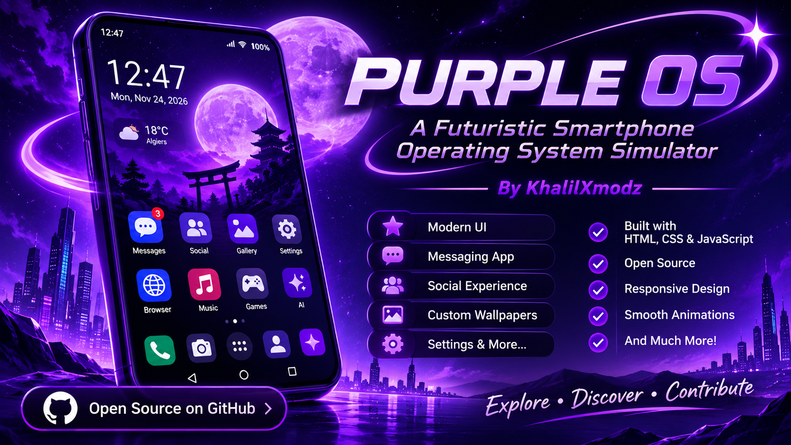

# PURPLE-SIMULATION-LIFE-OPENSOURCE
PURPLE OS is a futuristic, interactive smartphone OS simulator built with HTML, CSS, and JavaScript. Featuring a modern purple-themed interface, interactive applications, messaging, social interactions, customizable wallpapers, and more. Developed by KhalilXmodz.

🟣 PURPLE OS

A Futuristic Smartphone Operating System Simulator

PURPLE OS is an interactive smartphone simulator designed to recreate the experience of using a modern mobile operating system directly in your web browser.

Built with pure HTML, CSS, and JavaScript, PURPLE OS features a futuristic purple aesthetic, animated interfaces, interactive applications, and customizable settings.

✨ Features

- Futuristic UI: Modern purple-themed interface with glassmorphism effects.
- Interactive Home Screen: Smartphone-style home screen and navigation.
- Messaging App: Interactive conversations with virtual characters.
- Social App: A simulated social experience with posts and interactions.
- Customizable Wallpapers: Multiple wallpaper styles.
- Settings: Sound, music, volume, and interface customization.
- Local Storage: Save application data and settings in your browser.
- AI Integration: Optional OpenRouter API integration.
- Responsive Design: Designed for mobile devices and desktop browsers.
- Animations & Effects: Smooth transitions and interactive visual elements.

🛠️ Technologies

- HTML5
- CSS3
- JavaScript
- Browser Local Storage
- OpenRouter API (optional)

🚀 Getting Started

1. Clone this repository:
   
   git clone YOUR_REPOSITORY_URL

2. Open the project folder.

3. Open "PURPLE OS.html" in your browser.

4. Press START to launch the simulator.

🔓 Open Source

PURPLE OS is published as an open-source project. Developers are welcome to explore the source code, learn from it, and contribute improvements.

👨‍💻 Developer

KhalilXmodz

Project: PURPLE OS

📜 License

This project is intended to be distributed as open-source software. See the "LICENSE" file for licensing terms.

